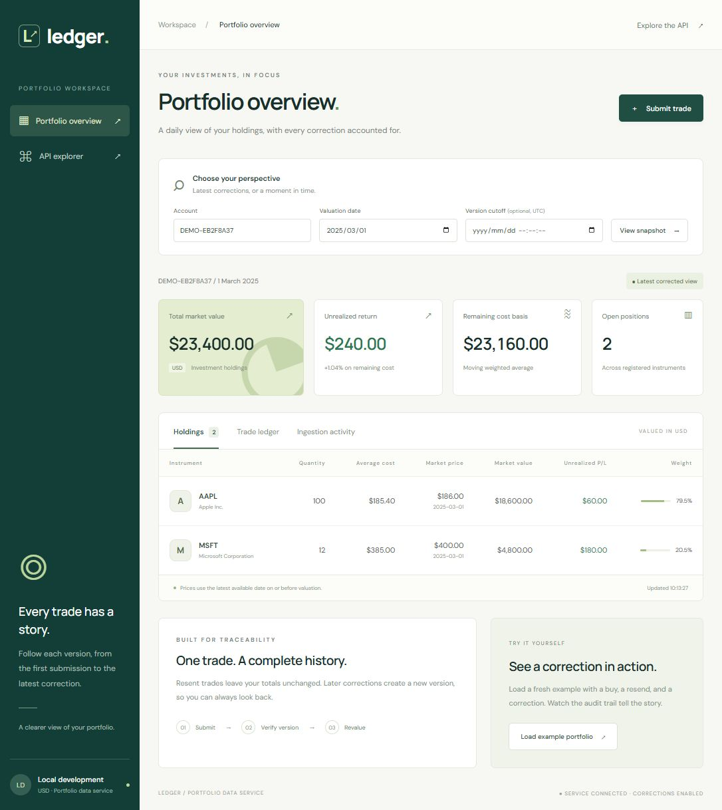

# Trade Ingestion & Portfolio Snapshots

A small portfolio application for ingesting trades, preventing duplicate application, retaining corrections, and reporting daily holdings and valuations in USD. Built for the Senior Developer technical assignment.

## Application preview

**Current app view — `main` (assignment implementation)**



*The example portfolio contains 100 AAPL units after a correction from 120, plus 12 MSFT units. Its market value on 1 March 2025 is $23,400, with $240 unrealized P/L.*

## Reviewer note

Please review the `main` branch for the technical assignment. It contains the application, automated tests, SQL artifact, setup instructions, and design notes.

The agreed scope is USD instruments, BUY/SELL trades, fractional quantities, moving weighted average cost, and no short selling. Historical snapshots default to the latest accepted corrections, with an optional upstream-version cutoff. FX and cash are outside the current implementation.

## Project status

The first end-to-end implementation is in place. All **15 integration tests passed in Release configuration** from the repository's current location on **2 November 2026**. The earlier Release solution build passed with no warnings or errors. A browser walkthrough verified the example portfolio, correction history, ingestion activity, historical cutoff, and fractional trade submission. The PowerShell demo verified duplicate/correction handling and expected snapshot totals.

Progress uses Markdown task lists and tables with a **Completed** column: `☐` outstanding, `☑` complete. Fresh-checkout setup, a recorded responsive/accessibility review, final submission review, and the narrated demo remain pending.

- [x] Create `Portfolio.sln` with `Portfolio.Api` and `Portfolio.Tests`.
- [x] Configure repository ignores and reference the API from the xUnit project.
- [x] Implement the trade API, LocalDB persistence, migrations, and reference data.
- [x] Preserve accepted revisions and audit duplicate, stale, and corrected submissions.
- [x] Implement daily USD snapshots with a historical version cutoff.
- [x] Implement the SQL artifact, moving-average cost, and supporting indexes.
- [x] Add structured logs, trace IDs, and safe rollout controls.
- [x] Implement the dashboard, trade submission form, and API explorer.
- [x] Verify critical flows with real SQL Server integration tests.
- [x] Verify the main UI flow in a browser and run the command-line demo.
- [x] Verify the Release tests after moving the solution into the Git repository.
- [ ] Verify setup on a fresh checkout with an empty application database.
- [ ] Complete a recorded responsive-layout and accessibility review.
- [ ] Complete the final GitHub submission review.
- [ ] Record the narrated application/architecture demo.

## Technology and structure

| Area | Technology |
| --- | --- |
| Backend | C#, ASP.NET Core .NET 8, minimal API endpoints |
| Persistence | EF Core 8.0.33, SQL Server LocalDB |
| Frontend | HTML, CSS, and JavaScript served by ASP.NET Core; no frontend build step |
| API explorer | Swashbuckle.AspNetCore 6.9.0 / Swagger UI |
| Tests | xUnit 2.5.3, ASP.NET Core test host 8.0.33, real SQL Server integration tests |
| Development | Windows, .NET SDK 8 or newer with the .NET 8 runtime, SQL Server LocalDB |

```text
Portfolio.sln
├── src/Portfolio.Api/
│   ├── Contracts.cs                 Request/response models and validation
│   ├── Program.cs                   API routes, configuration, and HTTP logging
│   ├── Domain/                      Instruments, prices, trade revisions, receipts
│   ├── Data/
│   │   ├── PortfolioDb.cs           EF Core model, constraints, indexes, and seeds
│   │   └── Migrations/              Versioned database schema and procedure install
│   ├── Services/
│   │   ├── IngestionService.cs      Version handling, locks, and ledger validation
│   │   └── SnapshotService.cs       Parameterized SQL snapshot execution
│   ├── Sql/PortfolioSnapshot.sql    Canonical portfolio stored procedure
│   └── wwwroot/                     Dashboard, styles, and browser interactions
├── tests/Portfolio.Tests/
│   ├── PortfolioFlowTests.cs        HTTP, persistence, concurrency, and rollout tests
│   └── DeploymentTests.cs           Clean database deployment and reapplication
├── database/deploy.sql              Generated idempotent schema/seed/procedure script
├── scripts/demo.ps1                 Repeatable submission/correction demo
├── docs/DEMO.md                     Suggested narrated walkthrough
└── SOLUTION.md                      Design decisions, assumptions, and trade-offs
```

## Local setup

Use Windows with the .NET SDK 8 or newer, the .NET 8 runtime, and SQL Server LocalDB. Visual Studio with the **ASP.NET and web development** workload can also run the solution. Node.js and npm are not required to build or run this application.

Confirm `dotnet --list-sdks`, `dotnet --list-runtimes`, and `SqlLocalDB info` in the terminal used for setup. Install LocalDB through Visual Studio Installer's individual components if it is unavailable.

From the repository root:

```powershell
dotnet tool restore
dotnet restore Portfolio.sln
```

The development machine uses the existing `ProjectModels` LocalDB instance. On a new machine, create it once if it does not already exist, then start it:

```powershell
# Run create only on first setup. Existing instances do not need recreation.
SqlLocalDB create ProjectModels
SqlLocalDB start ProjectModels
```

The configured database is `PortfolioAssignment` on `(localdb)\ProjectModels`, using Windows authentication. The application uses a separate database and does not modify other databases on that instance. The Development profile applies committed EF migrations and seeds two instruments and three prices at startup. To apply the migrations explicitly:

```powershell
dotnet ef database update --project src/Portfolio.Api
```

The local EF tool is pinned in `dotnet-tools.json`. Database files, build outputs, logs, and temporary artifacts are not committed. The checked-in preview under `docs/images` is documentation.

### Visual Studio startup

1. Open `Portfolio.sln`.
2. Set `Portfolio.Api` as the startup project.
3. Select the `http` launch profile and start debugging.
4. Open `http://localhost:5080` manually; the profile does not launch a browser automatically.

| Service | Configured address |
| --- | --- |
| Dashboard | `http://localhost:5080` |
| API | `http://localhost:5080/api` |
| Swagger UI | `http://localhost:5080/swagger` |
| OpenAPI document | `http://localhost:5080/swagger/v1/swagger.json` |
| Database connectivity check | `http://localhost:5080/health` |

The dashboard and API share one ASP.NET Core process and origin. No separate client process or proxy configuration is needed. The Visual Studio startup procedure is documented here; the recorded verification used the command line.

### Verified command-line development workflow

In a PowerShell terminal at the repository root:

```powershell
dotnet run --project src/Portfolio.Api
```

This selects the `http` launch profile, sets the environment to `Development`, initializes the database, and listens on `http://localhost:5080`. Stop the process with **Ctrl+C** before rebuilding to avoid Windows executable file locks.

Open the dashboard and click **Load example portfolio** to create a fresh demonstration account. It submits an AAPL buy, a duplicate, a correction, and a separate MSFT buy. Existing data is retained. The initial default account has no positions until trades are added; the current development database also contains accounts created during verification.

Snapshot selections are retained in the URL for refresh and bookmarks. The trade ledger and ingestion activity show all dates independently of the snapshot cutoff. Optional Google Fonts have system-font fallbacks.

### Connection configuration

The default local development connection is:

```text
Server=(localdb)\ProjectModels;Database=PortfolioAssignment;Integrated Security=True;Encrypt=False;MultipleActiveResultSets=False;Connect Timeout=15
```

This installed LocalDB connection did not support the requested encrypted transport. `Encrypt=False` is specific to the local development configuration. Override the connection for another SQL Server instance using its own authentication and certificate settings:

```powershell
$env:ConnectionStrings__Portfolio = 'Server=YOUR_SERVER;Database=PortfolioAssignment;Integrated Security=True;Encrypt=True;TrustServerCertificate=False'
dotnet run --project src/Portfolio.Api
```

LocalDB runs as your Windows user. A Windows service running under another identity needs a SQL Server instance accessible to that identity. Override the integration-test connection separately using `PORTFOLIO_TEST_SQL`; tests still create their own uniquely named databases.

## Tests and build

```powershell
dotnet build Portfolio.sln --configuration Release

# All integration tests; requires an accessible SQL Server / LocalDB instance.
dotnet test Portfolio.sln --configuration Release

# With the application running in another terminal:
./scripts/demo.ps1
```

Visual Studio **Test > Test Explorer** can also run the xUnit tests. The suite uses HTTP endpoints hosted by `WebApplicationFactory` and real SQL Server persistence. Tests create `PortfolioTests_<guid>` databases and remove only their own databases during cleanup. The login needs create/drop database permission. Connection failures fail the suite rather than silently skipping checks.

Verified on **2 November 2026**: **15 tests passed**, with no failures or skipped tests. Coverage includes duplicate/correction/audit flow, concurrent resends and corrections, historical cutoffs, corrected effective dates, moving-average sells, fractional quantities, full closure/reopening, oversell rejection, backdated-version validation, missing prices, request validation, rollout gates, and applying the deployment script twice to a clean database.

The PowerShell demo creates a fresh account and checks a 120-unit AAPL buy, duplicate, correction to 100, stale resend, corrected totals, and an earlier version cutoff. Expected latest totals are **100 units / $18,600 market value / $60 unrealized P/L**. The earlier cutoff retains **120 units / $22,320 market value**. The script prints the account's dashboard URL. Supply `-BaseUrl` to use another port.

The browser walkthrough verified the two-instrument example, accepted revision history, duplicate/correction receipts, historical cutoff, and a 0.5-unit trade. No automated frontend test suite or recorded responsive/accessibility review has been completed.

## API and SQL artifact

| Method | Route | Purpose |
| --- | --- | --- |
| POST | `/api/trades` | Submit an initial trade or a later correction |
| GET | `/api/accounts/{accountId}/snapshot?date=2025-03-01&asOf=2025-03-01T10:30:00Z` | USD snapshot with an optional upstream-version cutoff |
| GET | `/api/accounts/{accountId}/trades` | Latest accepted trade versions across all dates |
| GET | `/api/trades/{externalRef}/revisions` | Accepted history for a globally unique reference |
| GET | `/api/accounts/{accountId}/events` | Most recent 100 ingestion receipts |
| GET | `/api/instruments` | Registered instruments |
| GET | `/api/status` | Rollout status |
| GET | `/health` | Database connectivity check |

Example trade submission:

```json
{
  "externalRef": "TRX-1001",
  "accountId": "ACC-001",
  "instrumentId": "US0378331005",
  "side": "BUY",
  "quantity": 120,
  "price": 185.40,
  "tradeDate": "2025-03-01",
  "asOf": "2025-03-01T10:15:00Z"
}
```

Initial acceptance returns HTTP 201. Corrections and ignored resends return HTTP 200 with an explicit outcome. Equal timestamps with changed payloads return `version_conflict` and preserve the accepted version. Errors use Problem Details: 400 validation, 409 business conflicts, 422 unknown instrument, and 503 temporary disablement/busy database. The `X-Trace-Id` response header and problem `traceId` correlate with structured logs.

The API executes the procedure in [PortfolioSnapshot.sql](src/Portfolio.Api/Sql/PortfolioSnapshot.sql). It returns one result set for positions and another for account totals:

```sql
EXEC dbo.GetPortfolioSnapshot
    @AccountId = N'ACC-001',
    @ValuationDate = '2025-03-01',
    @AsOf = NULL;
```

[database/deploy.sql](database/deploy.sql) contains the generated idempotent schema, reference seed, stored procedure, and supporting index definitions. It can be applied with SSMS/sqlcmd against an existing chosen database; the script does not create the database itself.

Automatic migration is enabled by Development configuration. For deployment, apply reviewed migrations using a separate deployment identity and keep `Database:Initialize=false` for the application identity.

## Rollout controls

The `Ingestion` section supports:

```json
{
  "Ingestion": {
    "Enabled": true,
    "CorrectionsEnabled": true,
    "AllowedAccounts": ["ACC-001"]
  }
}
```

An empty allowlist permits all accounts. `Enabled=false` pauses ingestion while leaving reads available. `CorrectionsEnabled=false` permits new trades and deduplication but returns retryable 503 responses for later versions of existing trades. Disabling adoption never disables duplicate protection.

JSON configuration reloads affect subsequent requests; environment-variable changes require a restart. In-flight requests finish using the settings captured at entry. See [SOLUTION.md](SOLUTION.md) for the limits of this local configuration mechanism and multi-instance considerations.

## Task list: assignment requirements

| Task | Acceptance criteria | Completed |
| --- | --- | :---: |
| Ingest trades | Required fields accepted and persisted through EF Core to SQL Server. | ☑ |
| Prevent duplicate application | Earlier/same versions leave positions unchanged; concurrent resends remain safe. | ☑ |
| Process corrections | Later versions update derived results while retaining accepted history. | ☑ |
| Retrieve daily snapshots | Instrument quantities, USD valuations, and account totals for an account/date. | ☑ |
| Reference data and schema | Committed migrations, at least one instrument/price, and a deployment script. | ☑ |
| SQL deep dive | Parameterized stored procedure returns quantity, unit cost, market value, unrealized P/L, and account totals. | ☑ |
| Historical correctness | Version cutoff applied before effective-date filtering; correction and date-change tests pass. | ☑ |
| Supporting indexes | DDL included with migrations/deployment script; access paths explained in SOLUTION. | ☑ |
| Operational logging | Structured outcomes, request duration/status, and trace correlation. | ☑ |
| Safe adoption | Ingestion switch, correction gate, account allowlist, and documented behavior. | ☑ |
| Automated end-to-end verification | Real SQL Server tests cover the required flow and additional edge cases. | ☑ |
| Explain trade-offs | Cost/rounding/date assumptions, indexing, SARGability, archival, and .NET Framework 4.8 integration documented. | ☑ |

## Task list: agreed extensions and development conventions

| Task | Acceptance criteria | Completed |
| --- | --- | :---: |
| Latest corrected historical view | Default snapshots use accepted corrections; an optional cutoff selects earlier upstream versions. | ☑ |
| BUY/SELL and fractional quantities | Positive quantities/prices, supported decimal precision, and long-only validation. | ☑ |
| Moving-average cost | Sells remove remaining cost at the pre-sale average; full closure resets cost. | ☑ |
| Portfolio dashboard | Holdings, totals, valuation date, account, and optional cutoff. | ☑ |
| Trade entry and audit views | Submit trades, inspect accepted versions, and review ingestion outcomes. | ☑ |
| Example portfolio | Fresh account demonstrates a resend and correction without clearing existing data. | ☑ |
| API explorer | Swagger UI exposes routes and schemas for manual exploration. | ☑ |
| LocalDB persistence | Dedicated application database on the existing `ProjectModels` instance. | ☑ |
| Repeatable demo | PowerShell flow asserts latest and historical totals and prints a dashboard URL. | ☑ |

FX and cash are deferred optional scope. There is no separate frontend framework/build pipeline or scheduled snapshot materialization job in the current implementation.

## Deliverables and remaining checks

| Task | Completed |
| --- | :---: |
| Application source and tests committed in the local Git repository. | ☑ |
| README setup instructions and SOLUTION design notes. | ☑ |
| SQL artifact and supporting index/deployment definitions. | ☑ |
| Main browser walkthrough and repeatable API demo. | ☑ |
| Release build and all 15 integration tests verified. | ☑ |
| Verify restoration and setup on a fresh checkout with an empty app database. | ☐ |
| Verify the documented Visual Studio startup experience. | ☐ |
| Complete a recorded responsive-layout and accessibility review. | ☐ |
| Complete the final GitHub submission review. | ☐ |
| Record a 5–10 minute narrated application/architecture demo. | ☐ |

See [SOLUTION.md](SOLUTION.md) for business policies, temporal semantics, precision, concurrency, performance considerations, and .NET Framework integration.
